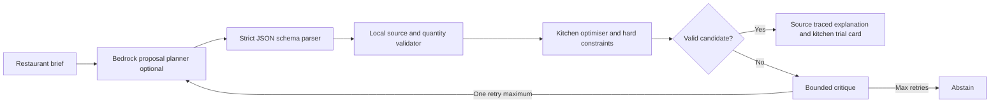

# Kitchen Intelligence — Bedrock-ready bounded agent
**19 November 2026 | Status: offline proposal gate tested; no AWS model invoked yet**

## Purpose
Add a *meaningful but tightly controlled* AI contribution to Hack the Fork Challenge 2. A model proposes **only** existing sourced preparation methods, bounded serving sizes, and small optional spice quantities. The deterministic engine alone calculates cost/protein/time and makes all dietary/equipment/stock decisions. This does NOT train a taste model and does NOT certify food safety or nutrition.

## Architecture

No model has access to credentials, arbitrary Python execution, browsers, customer records, purchases, deployment or source-data editing.

## Modules
- `src/menushift/agent_contract.py`: KitchenBrief, allowlisted proposal JSON Schema, strict parsing, deterministic safety gate and a hard maximum of 2 rounds / 6 proposals per round. Hard failures abstain.
- `src/menushift/bedrock_adapter.py`: optionally calls AWS Bedrock Converse. It uses the SDK credential chain, us-east-1 only, an explicit event-enabled model ID, no hard-coded secret or endpoint.
- `src/menushift/recipe_trial.py`: source-attributed review cards, measurements required and method-specific kitchen testing steps. NOT commercial cooking instructions.
- `scripts/bedrock_agent_smoke.py`: **manual only**. Never runs on Streamlit page load, CI, or public deployments.

## Before event access
1. Review PR and run `python -m pytest -q` and `ruff check src tests pages app.py`.
2. Keep Streamlit on local calculation mode; do not introduce temporary AWS dependencies into its production deployment.
3. Confirm research confidence labels and leave verified CSVs evidence-gated.
4. Ask the team to independently define at least 6 representative restaurant briefs, including no freezer, no peanut-safe yaji, strict soy allergy, impossible budget, low-cost baseline and unlabelled seasoning.

## In AWS Workshop Studio (only after team access is authorised)
1. Sign in using the organiser's temporary workshop flow and configure IAM credentials via the normal SDK session. Do not paste team access code or keys into ChatGPT, GitHub, Kiro prompts or code.
2. Check account region `us-east-1`, availability and permitted model ID in Bedrock console.
3. Clone the reviewed repository into Kiro/CloudShell. Install the optional dependency **there only**: `python -m pip install -e '.[aws]'`.
4. Run one small model probe with `BEDROCK_MODEL_ID=<actual-enabled-id> python scripts/bedrock_agent_smoke.py`.
5. Collect one accept and one reject/refusal example; record model ID, invocation date, request count, response time, parsing success and budget/food-review limitations. Compare with deterministic search and cheapest-feasible baseline.
6. If the model returns unsupported text, ingredients or quantities, **reject and report**. Do not attempt uncontrolled retries. Model output is never a food source.
7. If model access fails, demonstrate the deterministic offline version without claiming successful Bedrock usage.
8. Export logs/examples without secrets, commit repeatable code, and preserve a demo before workshop expiration. The temporary AWS environment is deleted after the event window.

## Model access and costs
The organisers describe temporary free sandbox access with shared quotas and model restrictions; this **does not** imply permanent free production inference. Keep AWS optional. Model permissions and structured-output support vary by enabled model. The adapter uses plain-text JSON with local validation for portability; optional native structured outputs can be explored only after checking a compatible allowed model.

AWS documentation checked:
- Converse API: https://docs.aws.amazon.com/bedrock/latest/userguide/conversation-inference.html
- Boto3 Converse request and response: https://docs.aws.amazon.com/boto3/latest/reference/services/bedrock-runtime/client/converse.html
- Structured outputs on supported models: https://docs.aws.amazon.com/bedrock/latest/userguide/structured-output.html

## Benchmark / honest judging statement
Report metrics **only after a test**: valid proposal percentage, constraint violation rate, unique eligible candidates relative to search, cost/protein changes at the same constraints, latency, human culinary approval. Mark model-produced novelty separately from deterministic enumeration. A bigger number of words in an AI explanation is not a meaningful advantage.

## Known limitations
No live Bedrock invocation, real model quality measurement, observed customer intent, complete food recipe, validated processing cost, chef preference labels or legal food-safety assessment has been completed.
